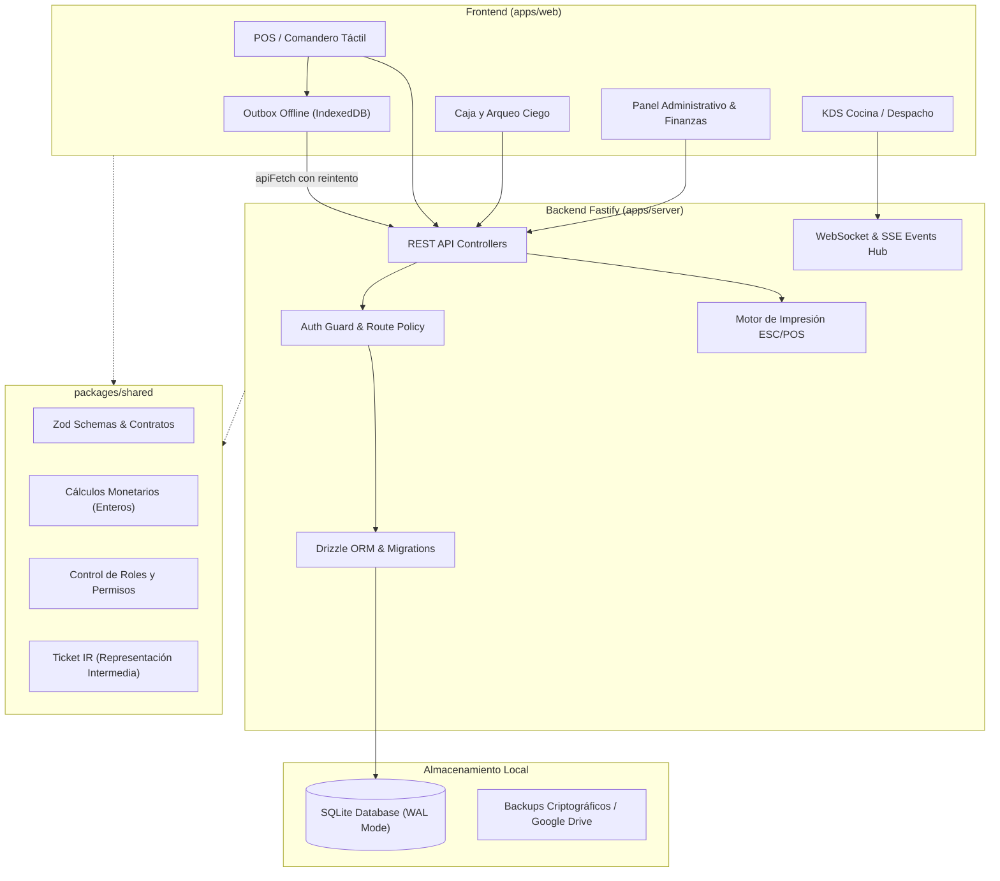
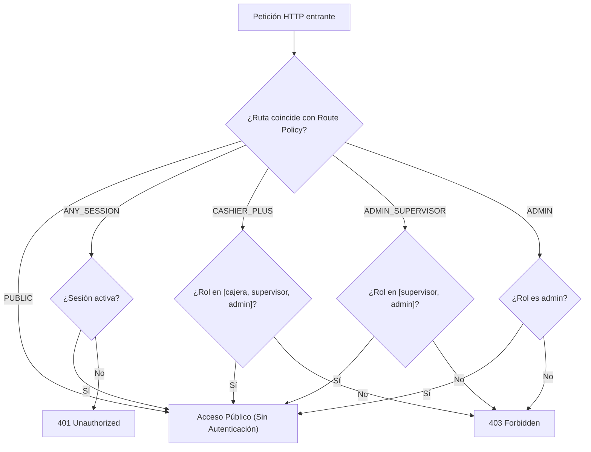
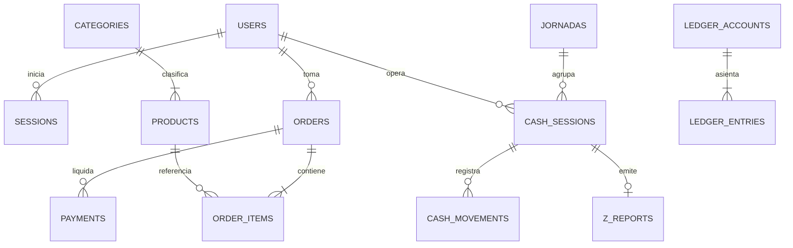

# DOSSIER DE CONTEXTO TÉCNICO Y OPERATIVO — TOCINETA ERP

> **Estado del Sistema:** Producción Go-Live / Rama `r2/go-live`  
> **Arquitectura:** Monorepo local de alta disponibilidad, Offline-First, SQLite con Drizzle ORM, Fastify HTTP/WS, React 18 SPA táctil, impresión térmica ESC/POS.  
> **Moneda y Finanzas:** Multidivisa estricta (USD / Bs) con precisión entera (centavos de dólar y micro-bolívares), sin redondeos de coma flotante.

---

## 1. Visión General del Proyecto

**TOCINETA** es un sistema operativo comercial y ERP gastronómico local concebido para operar de forma continua y autónoma en red local (LAN), tolerante a pérdidas de conectividad externa. Integra comandero táctil en salón, pantalla de comandas de cocina y barra (KDS), arqueo y cierre ciego de caja, facturación bimonetaria, contabilidad de partida doble, carta digital QR y control de hardware térmico de impresión.

---

## 2. Mapa Estructural de Archivos Esenciales

### 2.1 Raíz del Monorepo
- `package.json`: Scripts globales de orquestación (`dev`, `build`, `test`, `guard`, `lint`, `db:migrate`).
- `pnpm-workspace.yaml`: Definición de espacios de trabajo (`apps/*`, `packages/*`).
- `AGENTS.md`: Reglas estrictas de gobernanza, UI táctil, marca TOCINETA, WCAG AA y control de versiones.
- `BITACORA-DE-CONTEXTO.md`: Registro histórico vivo de decisiones técnicas (D1–D9), parches y resoluciones.
- `PRD.md`: Documento de requerimientos del producto gastronómico.
- `INFORME-DIRECTOR.md`: Resumen ejecutivo de avance para la dirección.
- `tsconfig.base.json`: Configuración base de TypeScript compartida.

### 2.2 Paquete Compartido (`packages/shared/src`)
- `money.ts`: Funciones de cálculo monetario de alta precisión (`toCents`, `fromCents`, tipos enteros).
- `payment-method-currency.ts`: Mapeo estricto de métodos de pago a sus monedas nativas (Efectivo USD/Bs, Pago Móvil en Bs, Zelle en USD, Punto de Venta/UBI en Bs, Transferencia en Bs).
- `rbac.ts`: Definición canónica de roles de usuario y permisos (`canUserProcessPayments`, matrices de acceso).
- `ticket-ir.ts`: Definición de *Ticket IR* (Intermediate Representation) desacoplado del driver de impresión.
- `thermal-logo.ts`: Algoritmos de rasterizado y formateo de logos para cabeceras de impresoras térmicas.
- `financial-contracts.ts`: Contratos y esquemas de validación de cierres Z y balances contables.

### 2.3 Servidor Local (`apps/server/src`)
- **Punto de Entrada y Servidor:**
  - `index.ts`: Inicialización del servicio, arranque del listener Fastify, registro de rutas y tareas de fondo.
  - `server.ts`: Ensamblado de plugins de Fastify, cors, websocket, manejo central de excepciones y static files.
- **Configuración y Seguridad:**
  - `config/route-policy.ts`: **Matriz maestra de seguridad**. Clasifica cada endpoint en `PUBLIC`, `ANY_SESSION`, `CASHIER_PLUS`, `ADMIN_SUPERVISOR` o `ADMIN`.
  - `config/paths.ts`: Determinación robusta de directorios de datos, base de datos y respaldos en Windows/Linux.
  - `plugins/auth-guard.ts`: Interceptor de peticiones Fastify que valida sesiones contra SQLite e inyecta `request.user`.
  - `plugins/websocket.ts`: Difusión en tiempo real de eventos de comanda, KDS y alertas de caja.
- **Base de Datos y Persistencia:**
  - `db/schema.ts`: Esquema completo Drizzle de tablas SQLite (usuarios, órdenes, caja, catálogo, asientos contables).
  - `db/connection.ts`: Inicialización del motor SQLite con Better-SQLite3 en modo `WAL` y claves foráneas activadas.
  - `db/migrate.ts`: Ejecutor secuencial de migraciones `.sql` inmutables (0000 a 0039).
  - `db/fresh-prod.ts`: Generación garantizada de bases de datos de producción vírgenes (con catálogo base o vacías).
- **Módulos de Dominio (`apps/server/src/modules/`):**
  - `orders/`: Creación de comandas, versionado y control de concurrencia optimista, aplicación de cupones, cálculo de totales.
  - `cashier/`: Cobro de órdenes, división de cuentas multidivisa, desglose de cambio (`change-split`), salidas de caja chica (`cash-expenses`).
  - `closures/`: Apertura/cierre de turnos de caja, arqueos ciegos (`blind-count`), generación de cierres Z y paridad contable.
  - `kds/`: Panel de cocina, avance de estados de líneas de preparación, despacho de platos y eventos en vivo.
  - `printing/`: Spooler de trabajos de impresión ESC/POS, reintentos térmicos, formateo y preview de tickets.
  - `menu/`: Gestión de categorías, productos, modificadores, sabores, disponibilidad instantánea y tasa de cambio del día.
  - `finances/`: Libro contable de partida doble (`ledger`), balance financiero y conciliación de caja.
  - `profitability/`: Escandallos, fichas técnicas de costos, recetas y márgenes de ganancia.
  - `staff/`: Gestión de personal, turnos de nómina, propinas y límites de intentos de PIN.
  - `backups/`: Generación de copias de seguridad criptográficas (`.age`), compresión y sincronización en la nube.
  - `updater/`: Sistema de verificación de actualizaciones y firmas criptográficas Ed25519.

### 2.4 Aplicación Web SPA (`apps/web/src`)
- `App.tsx`: Enrutador principal de la aplicación, control de pestañas activas, validación de permisos por rol y recarga segura.
- `context/AuthContext.tsx`: Gestión global de la sesión del usuario autenticado, roles y renovación de token.
- `api/client.ts`: Capa HTTP blindada (`apiFetch`, `apiJson`) con inyección transparente de Bearer token y manejo de errores 401/403.
- `ui/`: Librería de componentes táctiles nativos, conformes con tokens semánticos de Tailwind, WCAG AA y libres de emojis.
- `features/`:
  - `pos/`: Vista de toma de pedidos táctil, selector de categorías, personalización de platos, notas de cocina y confirmación.
  - `cashier/`: Flujo de facturación rápida, cobro mixto (USD + Bs), cálculo de cambio exacto, cierres de jornada e impresión.
  - `kds/`: Estaciones de preparación (Cocina / Plancha / Bebidas / Despacho) con temporizadores y cambios de estado con un toque.
  - `emergency/`: Comandas diferidas en contingencia de red y recuperación de órdenes encoladas.
  - `profitability/`: Asistente de configuración de costos, insumos y recetas gastronómicas.
  - `finances/`: Cuadre diario, flujo de caja y reportes de rentabilidad.
  - `staff/`: Control de asistencia, propinas del turno y administración de accesos del personal.
  - `settings/`: Configuración de negocio, tasas de cambio BCV/paralelo, impresoras de red y USB.

---

## 3. Matriz de Rutas del Sistema

### 3.1 Rutas de la Interfaz de Usuario (Frontend Tabs)

| Pestaña (Hash/Tab) | Vista / Componente | Roles con Acceso | Función Operativa |
|:---|:---|:---|:---|
| `home` | `HomeView` | `admin`, `supervisor` | Resumen ejecutivo, accesos rápidos e indicadores clave del día. |
| `pos` | `PosView` | `mesonero`, `cajera`, `supervisor`, `admin` | Toma de comandas de salón, delivery y mostrador con pantalla táctil. |
| `cashier` | `CashierView` | `cajera`, `supervisor`, `admin` | Recepción de pagos multimoneda, arqueo ciego, cierre Z y caja chica. |
| `kds` | `KdsView` | `cocinero`, `mesonero`, `cajera`, `supervisor`, `admin` | Cola de tickets de cocina en tiempo real dividida por estación. |
| `menu-admin` | `MenuAdminView` | `supervisor`, `admin` | Edición de precios, categorías, sabores de malteadas y disponibilidad. |
| `health` | `SystemHealthDashboard` | Todos los roles | Diagnóstico del servidor local, impresoras, latencia y WebSocket. |
| `emergency` | `DeferredPaperView` | `cajera`, `supervisor`, `admin` | Digitalización de comandas tomadas en papel durante contingencias. |
| `profitability` | `ProfitabilityDashboard` | `supervisor`, `admin` | Análisis de costos de recetas, márgenes brutos y asistentes de costos. |
| `staff` | `StaffManagementView` | `supervisor`, `admin` | Alta de personal, roles, asignación de PINs, turnos y nómina. |
| `qr-menu` | `QrMenuWebAdminView` | `supervisor`, `admin` | Configuración del menú público accesible vía código QR por comensales. |
| `owner` | `OwnerDashboardView` | `supervisor`, `admin` | Métricas avanzadas de rendimiento, ventas históricas y auditoría. |
| `finances` | `FinancesDashboardView` | `supervisor`, `admin` | Libro mayor, balances contables y estado de resultados. |
| `quotes` | `EventQuotesView` | `supervisor`, `admin` | Presupuestos y cotizaciones para catering y eventos especiales. |
| `partners` | `PartnersManagementView` | `admin` | Gestión de socios comerciales, participaciones y dividendos. |
| `settings` | `BusinessSettingsView` | `supervisor`, `admin` | Configuración de impresoras Windows/ESC-POS, datos fiscales y red. |

---

### 3.2 Rutas y Endpoints del Servidor (Backend Route Policy)

La política de seguridad (`apps/server/src/config/route-policy.ts`) gobierna la autorización en capa de transporte:

#### Clasificación Detallada de Endpoints:

1. **`PUBLIC` (Sin credenciales):**
   - `GET /api/health`: Chequeo básico de salud del servicio.
   - `GET /api/system-health`: Monitoreo general de recursos y estado de red.
   - `POST /api/auth/login`: Autenticación por PIN y emisión de token de sesión.
   - `GET /api/auth/users-public`: Lista básica de usuarios para pantalla de bienvenida.
   - `POST /api/auth/unlock-user`: Desbloqueo de usuario con PIN de supervisor tras superar intentos erróneos.
   - `GET /api/menu/pos`: Catálogo activo optimizado para comanderos.
   - `GET /api/qr-menu/*` & `GET /qr/*`: Carta digital y recursos públicos para comensales.
   - `POST /api/client-errors`: Registro de errores visuales de la SPA para auditoría remota.

2. **`ANY_SESSION` (Cualquier empleado autenticado):**
   - `GET /ws`: Canal dúplex en tiempo real para eventos de comandera y cocina.
   - `POST /api/orders`: Creación y actualización concurrente de pedidos.
   - `GET /api/orders`, `GET /api/orders/:id`, `GET /api/orders/unpaid`: Consulta de mesas y cuentas abiertas.
   - `GET /api/kds/orders`: Pantalla de cocina y barra.
   - `POST /api/kds/lines/:lineId/status`: Cambio de estado de un plato (pendiente -> en preparación -> listo).
   - `POST /api/kds/orders/:orderId/deliver`: Notificación de despacho de comanda.
   - `GET /api/printers`, `GET /api/print-jobs`: Consulta del estado del hardware de impresión.
   - `POST /api/auth/change-pin`: Cambio de PIN obligatorio o voluntario.
   - `PATCH /api/menu/products/:id/availability`: Activación o desactivación rápida de producto agotado.

3. **`CASHIER_PLUS` (`cajera`, `supervisor`, `admin`):**
   - `POST /api/orders/:id/pay`: Procesamiento de pagos multimoneda y cierre de cuenta.
   - `POST /api/orders/:id/void` & `incident`: Anulación de comandas e incidentes (valida PIN de supervisor).
   - `POST /api/jornadas/open` & `close`: Apertura y cierre de la jornada operativa del restaurante.
   - `POST /api/cash-sessions/open` & `blind-count`: Apertura de turno de cajera y arqueo ciego.
   - `POST /api/cash-expenses` & `GET /api/cash-expenses`: Registro y arqueo de salidas de caja chica.
   - `GET /api/reports/z-report/*` & `jornada/*`: Emisión de comprobantes y cuadre Z.
   - `POST /api/menu/exchange-rate`: Actualización de la tasa cambiaria del día.
   - `POST /api/print-jobs/:id/reprint` / `release`: Reimpresión forzada y resolución de atascos.

4. **`ADMIN_SUPERVISOR` (`supervisor`, `admin`):**
   - `* /api/menu/*`: Administración completa del catálogo de precios, combos e insumos.
   - `* /api/reports/*`: Reportes financieros consolidados, ventas por hora y estadísticas.
   - `* /api/finances/*`: Asientos contables, balances y movimientos bancarios.
   - `* /api/profitability/*`: Escandallos, margen de ganancia y costos unitarios.
   - `* /api/quotes/*`: Cotizador comercial para eventos.
   - `* /api/backups/*`: Disparo y descarga de respaldos locales cifrados.

5. **`ADMIN` (Exclusivo Administrador):**
   - `* /api/staff/*`: Creación de usuarios, cambio de roles, auditoría de asistencia.
   - `* /api/partners/*`: Distribución de capitales, dividendos y acuerdos comerciales.
   - `PUT|PATCH /api/business-settings`: Datos fiscales del local, logos, puertos de impresión y parámetros maestros.
   - `* /api/updater/*`: Instalación y aplicación de actualizaciones firmadas del sistema.
   - `* /api/support/*`: Diagnósticos profundos y apertura de soporte remoto seguro.

---

## 4. Estructura del Modelo de Datos (Drizzle / SQLite)

La base de datos SQLite opera en modo WAL (`Write-Ahead Logging`) garantizando transacciones concurrentes con cero bloqueos:

### Principales Entidades:
1. **Usuarios y Control (`users`, `sessions`, `pin_attempts`, `audit_logs`):**
   - Roles canónicos: `admin`, `supervisor`, `cajera`, `mesonero`, `cocinero`, `despachador`.
   - Autenticación por PIN hasheado (Scrypt).
   - Bloqueo por fuerza bruta tras intentos fallidos consecutivos con desbloqueo supervisor.
2. **Operación Comercial (`orders`, `order_items`, `payments`, `coupons`):**
   - Estado de órdenes: `abierta`, `en_cocina`, `lista`, `entregada`, `pagada`, `anulada`.
   - Modos de consumo: `comedor` (mesa), `llevar` (mostrador), `delivery`.
   - Precios y subtotales en centavos enteros con desglose de divisa original.
3. **Control de Caja y Auditoría Z (`jornadas`, `cash_sessions`, `cash_movements`, `cash_expenses`, `z_reports`):**
   - El arqueo ciego impide al cajero ver el monto esperado antes de contar el dinero físico.
   - Discrepancias registradas automáticamente en asientos de ajuste contable.
   - Cierre Z inmutable con hash SHA-256 de verificación.
4. **Contabilidad General (`ledger_accounts`, `ledger_entries`):**
   - Estructura de partida doble estricta: Suma de Débitos = Suma de Créditos en todo momento.

---

## 5. Reglas de Negocio y Principios Inmutables

1. **Precisión Financiera:**
   - Todo monto monetario se almacena como `INTEGER` (centavos de USD o micro-unidades de Bs). Prohibido el uso de flotantes para representar dinero.
2. **Resiliencia Offline y Outbox:**
   - La toma de comandas en comandero no se interrumpe si la red Wi-Fi oscila; los tickets se encolan en el `outbox` de IndexedDB y se sincronizan al recuperar enlace con control de idempotencia (`idempotency_key`).
3. **Inmutabilidad en Cocina:**
   - Una vez que una comanda entra a preparación en KDS, cualquier modificación requiere autorización explícita para evitar mermas ocultas en cocina.
4. **Gobernanza de Diseño Táctil:**
   - Modo claro de alto contraste (WCAG AA).
   - Botones con altura mínima de `48px` para interacción táctil rápida con una sola mano.
   - Cero dependencias de conexión externa a internet para la operativa diaria.
