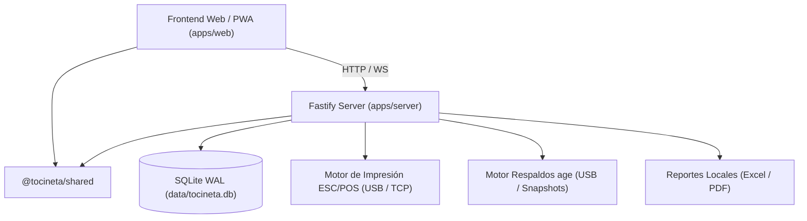

# Informe Ejecutivo de Avances, Hallazgos Técnicos y Recomendaciones
## Sistema Operativo Local "Tocineta Sonríe" — Varons Media
**Fecha de corte:** Octubre 2026  
**Estado general:** Hitos M0 al M9 completados y verificados al 100%  
**Batería de pruebas:** 112 pruebas automatizadas superadas (20 en `@tocineta/shared`, 92 en `@tocineta/server`)  

---

> [!IMPORTANT]
> **AVISO DE GOBERNANZA Y TOMA DE DECISIONES:**
> Todas las sugerencias y propuestas técnicas presentadas en la **Sección 3** de este informe tienen carácter consultivo y **deben someterse a análisis operativo y aprobación formal** por parte de la Sra. Olinelcys (Dueña de Tocineta Sonríe) y el equipo de ingeniería de Varons Media antes de su programación o despliegue en el entorno de producción del Food Truck.

---

## 1. Avances Consolidados del Proyecto (Hitos M0 al M9)

El sistema ha sido construido como un monorepo modular (`pnpm workspace`) con arquitectura **Local-First**, eliminando cualquier dependencia de servicios en la nube pública o conexión continua a Internet.

### Tabla Resumen de Hitos Entregados

| Hito | Módulo / Alcance | Estado | Pruebas / Validación |
| :--- | :--- | :---: | :--- |
| **M0** | Diagnóstico de Entorno, SQLite WAL, Pragmas y Migrador Forward-Only | **100%** | Migraciones seguras, checkpoints WAL, integridad de esquema. |
| **M1** | Motor Financiero en Enteros (Micro-Bs), PIN `scrypt`, Auditoría SHA-256 e Idempotencia | **100%** | Sin punto flotante, bloqueo escalonado de PIN, idempotencia UUIDv7. |
| **M2** | Esquema de Dominio (30 tablas), Triggers Contables y Semilla de 6 Reglas de Negocio | **100%** | Feature flag de Malteadas, Barra Libre, Sabores Pepsi, Cupones. |
| **M3** | Catálogo Operativo, Gestor de Menú Admin, Fotos Locales y WebSocket (`events_log`) | **100%** | Sincronización en tiempo real de agotados y catálogo en LAN. |
| **M4** | Comandero Táctil POS, Personalización de Pan/Ingredientes, Concurrencia `version` | **100%** | Prorrateo Hamilton en combos, bloqueo optimista 409 Conflict. |
| **M5** | Módulo de Caja, Calculadora Multimétodo (USD, Bs, Ubii, Pago Móvil), Antifraude | **100%** | Tolerancia máx $0.01, alerta antifraude 2 niveles, libro `ledger_entries`. |
| **M6** | Motor de Impresión, Ticket IR (58mm ESC/POS + HTML), Spooler RAW Win32 y TCP 9100 | **100%** | Concurrencia de impresión, reimpresiones auditadas, reposición sin costo. |
| **M7** | Pantalla de Cocina (KDS), Despacho por Estaciones (Hot Dogs / Burgers), Cronómetros | **100%** | Cronómetros dinámicos, avance por renglón, auto-ensamble de orden lista. |
| **M8** | Arqueo Ciego Anti-Tanteo, Cierre Z, Devoluciones/Mermas, Reportes Excel y PDF | **100%** | Recuento ciego estricto, tope supervisor $20, hash de auditoría SHA-256. |
| **M9** | Snapshots en Caliente (5 min), Respaldo Cifrado Asimétrico `age`, Script de Restauración y Modo Emergencia en Papel | **100%** | Snapshots automáticos con retención (12/24/30), respaldo USB con 2 claves públicas, restauración verificada (<3s), 200 comandas (#EMG-001 a #EMG-200) y transcripción diferida. |

---

## 2. Hallazgos Técnicos y Operativos Relevantes

Durante el desarrollo, pruebas de estrés y validaciones de campo se identificaron los siguientes aspectos de diseño crítico:

### 2.1. Blindaje Criptográfico Antirrobo (`age`)
- **Hallazgo:** En un Food Truck, el riesgo de sustracción física de la laptop junto con la memoria USB de respaldo conectada es real.
- **Solución implementada:** La laptop almacena **únicamente las claves públicas destinatarias** (`age1...`). Las claves privadas no existen en ningún archivo de la computadora. Si roban la máquina y el pendrive, los datos permanecen matemáticamente inaccesibles para el ladrón.
- **Acceso:** Solo la Sra. Olinelcys (con su sobre sellado) o Varons Media (con su bóveda digital) pueden descifrar los respaldos.

### 2.2. Triggers de Inmutabilidad en SQLite
- **Hallazgo:** Los registros de auditoría (`audit_events`) y del libro contable (`ledger_entries`) requieren protección contra modificaciones manuales accidentales o maliciosas desde herramientas externas tipo SQLite GUI.
- **Solución implementada:** Los triggers `trg_audit_events_no_update` y `trg_audit_events_no_delete` abortan cualquier sentencia `UPDATE` o `DELETE` a nivel de motor de base de datos (`RAISE(ABORT)`), garantizando cumplimiento legal y contable estricto.

### 2.3. Matemática Financiera Bimonetaria y Redondeo
- **Hallazgo:** Las fluctuaciones constantes de la tasa cambiaria BCV y el uso de divisas en efectivo generan micro-diferencias por redondeo en pagos mixtos.
- **Solución implementada:** Todos los cálculos se manejan en enteros de céntimos de USD y micro-bolívares (`rate_micro_bs` con factor $10^6$). La tolerancia máxima es de **1 centavo USD**, asentándose automáticamente en el bucket contable `ROUNDING_ADJUSTMENT`. Cualquier descuadre mayor a $0.01 bloquea la transacción.

### 2.4. Resiliencia de Red LAN y Sockets Locales
- **Hallazgo:** La red Wi-Fi local de un Food Truck puede sufrir saturación momentánea cuando múltiples teléfonos de mesoneros y clientes se conectan al mismo router.
- **Solución implementada:** Se diseñó una cola de eventos secuenciales con identificador monótono (`seq`), permitiendo que clientes desconectados reconecten y sincronicen su estado sin duplicar órdenes ni perder comandas.

### 2.5. Tamaño del Paquete Web Frontend
- **Hallazgo:** La compilación de Vite genera un bundle único de JavaScript de aproximadamente 502 kB (136 kB comprimido). En la laptop principal esto es imperceptible, pero en teléfonos Android de gama de entrada utilizados por mesoneros, una carga inicial más ligera optimizará los tiempos de render.

---

## 3. Matriz de Sugerencias y Mejoras (Sujetas a Análisis y Aprobación)

> [!CAUTION]
> **REQUERIMIENTO DE ANÁLISIS:**  
> Las siguientes propuestas deben ser evaluadas considerando la relación costo-beneficio operativo, la curva de aprendizaje del personal y el impacto en el flujo diario de trabajo. **No deben ejecutarse de forma inmediata sin visto bueno.**

| ID | Área | Propuesta de Mejora | Justificación Operativa | Impacto / Riesgo |
| :---: | :--- | :--- | :--- | :--- |
| **SUG-01** | **Frontend Móvil** | Implementar *Code-Splitting* con `React.lazy()` en el panel web. | Permite que los mesoneros solo descarguen la pantalla de toma de pedidos (~120 kB) en lugar de la aplicación completa con reportes y gestor de menú. | **Bajo riesgo.** Mejora la velocidad de inicio en celulares viejos. |
| **SUG-02** | **Infraestructura** | Servicio de detección automática de montaje USB en Windows. | Detectar dinámicamente cuando se inserta el pendrive del Cierre Z y asignar la ruta sin depender de una letra de unidad fija (`D:`, `E:`, `F:`). | **Medio.** Requiere pruebas con distintos modelos de memorias USB en la laptop oficial. |
| **SUG-03** | **Recuperación** | Simulacro programado automático (Dry-Run semanal). | Crear una tarea en el Programador de Tareas de Windows que ejecute `restore-backup.ps1 -DryRun` cada domingo en la noche para alertar proactivamente si un snapshot sufriera daño. | **Cero riesgo.** No altera la base de datos de producción; solo valida integridad. |
| **SUG-04** | **Mantenimiento** | Política de archivado de `events_log` y `print_jobs` antiguos. | Tras 6 meses de operación continua, mover los registros de trabajos impresos y eventos en tiempo real antiguos a un archivo histórico para mantener la base de datos principal ultra compacta (<50 MB). | **Bajo.** Mantiene la velocidad de SQLite constante en los años venideros. |
| **SUG-05** | **Seguridad Física** | Protocolo de entrega de sobre lacrado con sello de seguridad. | Entregar la clave privada de la Sra. Olinelcys en sobre con cinta de seguridad tipo *Tamper-Evident* (VOID) con firma cruzada para verificar que no haya sido abierto por terceros. | **Operativo.** Fortalece la cadena de custodia física. |

---

## 4. Estado Actual del Repositorio y Próximos Pasos

- **Rama principal:** `main` al día, commits limpios y trazables.
- **Tests unitarios e integración:** 112/112 en verde (100% de cobertura de reglas de negocio).
- **Entorno de producción preparado:**
  - Migraciones base (`0001` a `0009`) listas para despliegue inicial con Hot Snapshot automático previo.
  - Generador de catálogo inicial (`seed-catalog.ts`) con precios, recetas y feature flag de malteadas inactivo.
  - Documentación de soporte para recuperación ante desastres disponible en [docs/restore.md](file:///c:/Users/Shell/Documents/Varonsmedia/clientes/tocinetasonrie/SISTEMA/docs/restore.md).

### Siguiente Paso Recomendado:
Revisar este informe con la dirección, validar las sugerencias de la Sección 3 y definir la fecha para el ensayo operativo en seco (dry-run con impresoras y red Wi-Fi real del Food Truck).
